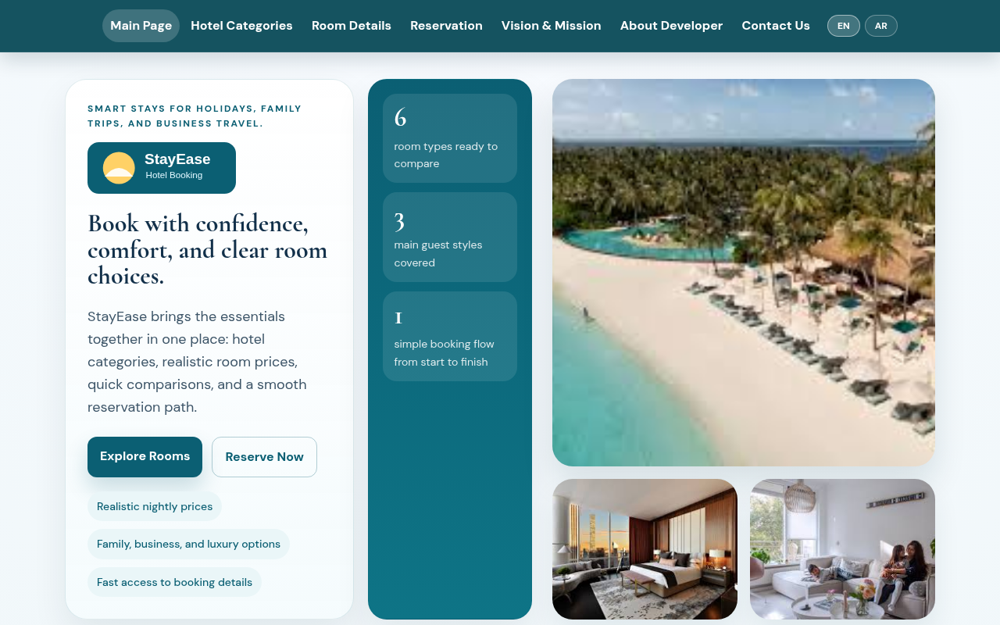
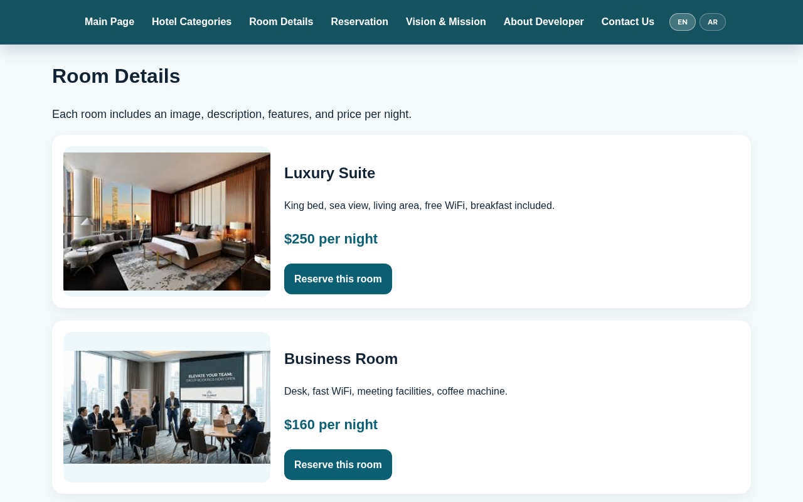

# StayEase

A static, multi-page hotel booking website with an English / Arabic toggle.

*Screenshot: the home page rendered from the files in this repo, served locally in a desktop browser.*

## Pages

`index.html` (home), `categories.html`, `rooms.html`, `reservation.html`, `vision-mission.html`, `about-developer.html`, `contact.html`, plus `airbnb-egypt.html` and `student-camp.html`.

## How it works

- Plain HTML, CSS (`css/style.css`) and JavaScript (`js/script.js`, `js/i18n.js`). No build step.
- Language toggle (EN / AR) is handled in `js/i18n.js`.
- The reservation page calculates an estimated total (nightly rate x nights) in the browser from the room chosen.
- A GitHub Actions workflow deploys the site to GitHub Pages.

## Limits (what this repo does not do)

- There is no backend. The reservation and contact forms only show a message in the page. Nothing is stored or sent, and no real booking or payment happens.
- Prices and the numbers on the home page (such as "6 room types") are sample content, not live data.
- The photos in `images/` are not documented as owned or licensed. Check their source before reusing them.

## Run locally

Open `index.html` in a browser, or serve the folder, for example `python -m http.server`.
